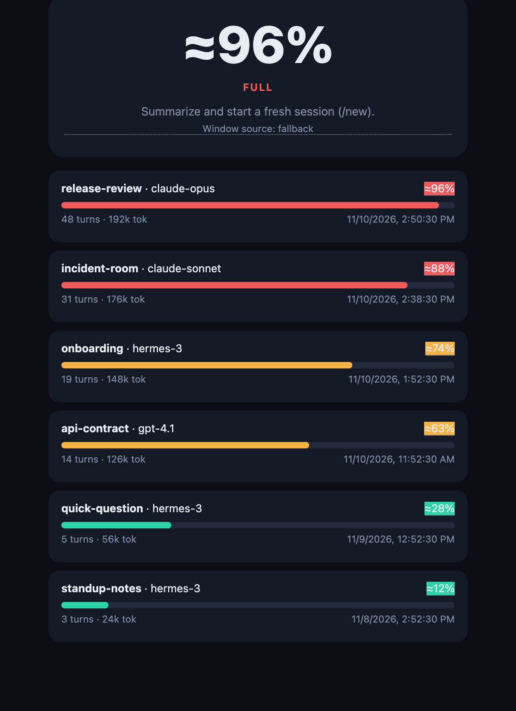

<p align="center"></p>

# hermes-gauge

Your AI agent never tells you its context is full. Now it does.

> See how full your agent's head is.

This plugin is the [Hermes Gauge context window gauge](https://hermes-gauge.sidelight.ch) for the Hermes agent. It is published by [Sidelight AI Consulting for Swiss firms](https://sidelight.ch).

<p align="center"></p>

The demo dashboard (`make demo`) with its six fictional sessions. The plugin reads the same numbers from your own sessions.

## Install

Hermes has to be installed already.

```bash
hermes plugins install SidelightAi/hermes-gauge --enable
```

In Hermes Desktop: Capabilities → Plugins → Install from Git, with `SidelightAi/hermes-gauge`. Restart Hermes if it is already running. The longer install notes are further down.

## Thirty seconds

1. Send a message. The Desktop chip names the conversation and a percentage of the window the model can actually use.
2. At 60% it says WATCH. At 85% it says FULL, and a short notice asks for a summary, then `/new`. Hermes Gauge only watches; it never changes the chat.
3. `/gauge` is one line for this conversation. `/gauge audit` is the peaks. `/gauge incidents` is the page that still shows what happened after a summary reset the counter. `/gauge window 200000` records the window when the gauge shows an em dash.

## Glossary

| Word | Means |
| --- | --- |
| full | The reliable window is almost used up. |
| room left | Tokens still available in that reliable window. |
| memory | What the conversation, the tools and the system prompt are holding. |
| auto-summary | Hermes shortened the older part of the chat. The live counter starts over. |
| fresh start | `/new`. The counter is empty because the conversation started again, not because it was summarized. |

Preferences live in `~/.hermes/plugin-data/hermes-gauge/config.yaml` (or `$HERMES_HOME`). An update replaces the file shipped inside the plugin, not this one. `language` is `auto`, `en` or `fr`. `alerts.route: session` means this conversation.

## Why

The gauges people already have go wrong in public: the wrong maximum, a stale percentage after compaction, or a number past 100%, so the next message looks more expensive than it is. hermes-gauge shows how full the session is, where that window size came from, and what is taking the space, before the thread quietly drops the beginning.

## What it does

Five tools, the hooks that feed them, and the `gauge-viewer` skill. `gauge_action` records the reply to a WATCH or FULL notice (`compact`, `new`, `compact+new`, or `dismiss`) and asks Hermes to run `/compact` and `/new`. It does not summarize the transcript. The skill tells the agent when to check and when to say so out loud. Readings stay in the plugin SQLite database (`~/.hermes/plugin-data/hermes-gauge/data.db`), one row per session, so `gauge_report` can list them later.

A compaction resets the live counter: the gauge shows where a session stands now, not what it went through. The past is kept elsewhere. The audit lists each session's peak and compactions. The incident report is the only view that counts past incidents (compactions, provider errors, sessions that reached FULL). Both are described below.

`gauge_check` on a session whose model reported a 200k window, after 280,000 counted characters:

```json
{
  "window_tokens": 200000,
  "nominal_window": 200000,
  "effective_window": 200000,
  "degrade_factor": 1.0,
  "output_reserve": 0,
  "window_source": "detected",
  "estimated_tokens": 140000,
  "fill_percent": 70.0,
  "fill_display": "≈70.0%",
  "remaining_tokens": 60000,
  "status": "WATCH",
  "approximate": true,
  "anchor_valid": true,
  "breakdown": {
    "system_prompt": 0,
    "tools": 0,
    "skills": 0,
    "conversation": 140000
  },
  "model": "claude-opus-4-6",
  "turns": 1,
  "session_id": "release-review",
  "window_label": null,
  "agents": [],
  "recommendation": "About 60k tokens of headroom left. Finish the current topic first; avoid starting anything big.",
  "notification": "Context crossed into WATCH. Finish the current topic before starting something new.",
  "in_flight": {
    "note": "Compaction is close. This is what is in the window right now.",
    "model": "claude-opus-4-6",
    "turns": 1,
    "estimated_tokens": 140000,
    "breakdown": {
      "system_prompt": 0,
      "tools": 0,
      "skills": 0,
      "conversation": 140000
    }
  }
}
```

`window_source` is `detected` (the model's `context_length`), `configured` (set for this session), `fallback` (the labeled default), or `unresolved`. `window_tokens` and `effective_window` are the usable window times `degrade_factor`. The example above is an Opus-class id, so the factor stays 1.0 and the two windows match. A model id that contains `flash`, `nano`, `lite`, `mini`, `small`, `fast`, `haiku`, or `air` uses a smaller factor, and the status is scored on that smaller window. The reply also carries `policy_verdict`, the dull threshold for that model. After compaction, or before the max is known, the same call comes back with `fill_display` `—`, `fill_percent` `null`, and `status` `UNKNOWN`. No percentage is invented.

`gauge_set_window` stores the override on that session only:

```json
{
  "model": "claude-opus-4-6",
  "session_id": "release-review",
  "window_tokens": 128000,
  "window_source": "configured",
  "reset": false
}
```

`gauge_report` lists tracked sessions, fullest first. Clock fields omitted:

```json
{
  "sessions": [
    {
      "session_id": "release-review",
      "model": "claude-opus-4-6",
      "estimated_tokens": 140000,
      "fill_percent": 70.0,
      "fill_display": "≈70.0%",
      "status": "WATCH",
      "window_tokens": 200000,
      "window_source": "detected",
      "window_label": null,
      "turns": 1,
      "approximate": true
    },
    {
      "session_id": "standup-notes",
      "model": "hermes-3",
      "estimated_tokens": 24000,
      "fill_percent": 12.0,
      "fill_display": "≈12.0%",
      "status": "OK",
      "window_tokens": 200000,
      "window_source": "fallback",
      "window_label": null,
      "turns": 1,
      "approximate": true
    }
  ],
  "session_count": 2,
  "total_estimated_tokens": 164000
}
```

On a subject with several agents, `estimated_tokens` is the sum of their contributions and the status uses the smallest window. The label is `window: smallest model of the subject`. The breakdown lists each agent and model.

Hooks: `post_llm_call` for a finished turn, `on_stream_delta` / `on_stream_end` for streaming, `api_request_error` and `post_api_request` for provider failures and reported usage, `post_compaction` to drop the stale usage anchor, `on_session_reset` to clear a `/new`, and `subagent_stop` to fold a child agent into the subject. A missed hook is logged. `gauge_check` can recompute from `conversation_history` when the hook never wrote a row. A warning fires once per crossing into WATCH or FULL, not on every check. The same crossing can push a short notice; see Alerts & commands.

## Alerts & commands

Push, natural commands, and exports. Status bands are unchanged by default: WATCH at 60%, FULL at 85%.

`hermes-gauge/config.yaml`:

```yaml
gauge:
  alerts:
    enabled: true
    on: [WATCH, FULL]
    cooldown_minutes: 30
    route: session
```

`enabled` turns the push on. `on` lists the statuses that push (WATCH, FULL, or both). `cooldown_minutes` is per status per session: a session that leaves WATCH and comes back inside the window does not ping again. `notified_status` on the session row is the other half of that dedup — while the status stays put, nothing is sent. A later FULL still pushes, because FULL is a different status. The in-tool `notification` field uses the same once-per-crossing rule.

### Where the alert goes: `alerts.route`

| Value | The alert lands in |
| --- | --- |
| `session` (default) | the thread the session lives in |
| `home` | the home channel of the platform that session lives on |
| `home:<platform>` | the home channel of a named platform, e.g. `home:telegram` |
| `custom:<platform>:<chat_id>` | one explicit chat, e.g. `custom:telegram:-1001234567890` |

With `route: session`, which is the default, an alert follows the session that crossed the threshold. If you use the agent from several channels, you get an alert in every thread whose session is concerned, and only there. A session in a Telegram topic pings that topic, not your phone's other chats. Set `home` or a `custom:` target when you would rather have one place that collects every alert.

`session` goes through `PluginContext.post_message`, which can only reach the session the hook just updated. `home` and `custom:` go through the public CLI, `hermes send --to <target>`, which is the one way a plugin can name another chat. That send runs in the background and is best effort: it does not hold up the turn, and a failed send is logged, not retried. A route that cannot be resolved (`home` on a local desktop session, which has no platform) stays on the session instead of vanishing. Set `HERMES_BIN` if `hermes` is not on the `PATH` of the gateway.

A crossing sends one message on `alerts.route`, however many hooks saw it. The status sentence names the conversation and its fill. When the dull-threshold recommendation (`policy.preset`, `standard` by default) is due on the same turn, it rides in the same message instead of arriving as a second bubble. On a FULL crossing:

```text
"release-review" is 92% full. Quality drops from here. Ask for a summary, then send /new and paste it. Hermes Gauge only watches; it never changes your chat.

Hermes Gauge — session release-review : 92 % effectif, seuil débile 70 % : recommandé = compacter, puis nouvelle session.
```

The recommendation line is in French. Two hooks that see the same turn (or two processes sharing the database) cannot both send: the crossing and the cooldown are each claimed with one conditional database update, and a send that fails releases the claim so the next turn retries. The message is text. `gauge_action` can record a reply (`compact`, `new`, `compact+new`, `dismiss`) and ask Hermes to run `/compact` and `/new`, but the plugin never compacts or starts a session itself.

With the default route the message is posted with `PluginContext.post_message` on the session the hook just updated (the channel Hermes uses for a user-visible notice; the local surface publishes `notification.show`). No live session means the crossing is recorded and not retried until the status changes.

The `gauge-viewer` skill answers in the user's language:

| They say | Tool | Reply |
| --- | --- | --- |
| `gauge`, `GaugeCheck`, `où j'en suis` (context) | `gauge_check` | One line: fill, status, session |
| `gauge report` | `gauge_report` | Summary line, then every session |
| `/gauge` | same check | One line |
| `/gauge report`, `/gauge md`, `/gauge json` | `gauge_report` | text, markdown, or JSON |
| `/gauge report write` (or `md write`) | `gauge_report` with `write` | the report as a `.md` file, attached |
| `/gauge audit` | audit | peaks, compactions, what the context is made of |
| `/gauge incidents` | incident report | a verdict line and the report page, attached |
| `/gauge config` | preferences | every setting and where its value comes from |
| `/gauge config set key=value` | preferences | saves one or more settings to `config.yaml` |

`gauge_report` always starts with the weakest link — the highest fill, which is not always the largest character count when windows differ. Active sessions come first: a frozen or archived session only becomes the weakest link when no active session is left.

```text
2 active sessions — weakest link: Release review · thread 7 95% FULL
```

### Session names, last activity, state

The report reads Hermes' own `state.db` (read-only) to name sessions the way you do. A session with a title shows the title, plus `· thread N` when it lives in a thread (`· fil N` on the French incident page). Without a title, or without a `state.db`, the id is the name, exactly as before.

Each row carries a last activity time (the later of `state.db` and the plugin's own last reading) and one of three states:

| State | Meaning |
| --- | --- |
| `active` | not archived, not ended, last activity within 24 hours |
| `frozen` | ended, or quiet for more than 24 hours |
| `archived` | archived in Hermes, manually or automatically |

When any session is frozen or archived the summary says so: `4 sessions (2 active, 1 frozen, 1 archived) — weakest link: …`. The text report adds `last <time> <state>` to each row, and the markdown table gets `Last activity` and `State` columns.

`format` is `text` (default), `md`, or `json`. Unknown values fall back to text. `text` adds a `text` field. `md` adds `markdown`: a title, that summary with the weakest link underlined, a table (session, fill, status, turns, model, last activity, state), and a UTC timestamp. `json` is the stable object below and omits `text` and `markdown`.

`write: true` (`/gauge report write`) saves the markdown report to `~/.hermes/plugin-data/hermes-gauge/reports/gauge-report-<UTC stamp>.md` and returns `written`, `path` and a `MEDIA:<path>` line. Hermes attaches that file to the reply, so Telegram gets a document, not a wall of text. The 30 most recent files of each kind are kept.

```json
{
  "summary": "1 active session — weakest link: Release review · thread 7 95% FULL",
  "weakest_link": {
    "session_id": "release-review",
    "name": "Release review · thread 7",
    "model": "claude-opus",
    "fill_percent": 95.0,
    "fill_display": "≈95.0%",
    "status": "FULL",
    "turns": 1
  },
  "format": "json",
  "sessions": [
    {
      "session_id": "release-review",
      "model": "claude-opus",
      "estimated_tokens": 190000,
      "fill_percent": 95.0,
      "fill_display": "≈95.0%",
      "status": "FULL",
      "window_tokens": 200000,
      "window_source": "fallback",
      "window_label": null,
      "turns": 1,
      "first_seen": 1700000000.0,
      "last_seen": 1700000000.0,
      "approximate": true,
      "title": "Release review",
      "name": "Release review · thread 7",
      "source": "telegram",
      "thread_id": "7",
      "last_activity": 1700000000.0,
      "state": "active"
    }
  ],
  "session_count": 1,
  "by_state": { "active": 1, "frozen": 0, "archived": 0 },
  "names_from_state_db": true,
  "total_estimated_tokens": 190000,
  "generated_at": 1700000000.0,
  "written": false,
  "path": null
}
```

`text` and `markdown` are absent on `format: json`. `weakest_link` is `null` when every row is an em dash. A second session in `sessions` uses the same fields. Every key an older client reads is still there with the same meaning. What v0.5 adds: `name` on `weakest_link`; `title`, `name`, `source`, `thread_id`, `last_activity` and `state` on each session; and `by_state`, `names_from_state_db`, `written` and `path` on the object.

`gauge_render` draws that same weakest link as one standalone SVG (segmented pills, `#032A27` / `#E8B54A`, `#C45C48` when the status is FULL). The return value includes `svg`. `write: true` saves the only file, `~/.hermes/plugin-data/hermes-gauge/gauge.svg`.

## Preferences

One file holds every setting: `hermes-gauge/config.yaml`. Three doors lead to it, and they run the same checks.

- **By hand**, in the file. Comments are yours.
- **From Telegram**, `/gauge config` to read it and `/gauge config set key=value [key=value …]` to change it. The change is saved to the file, so it survives a restart.
- **From the Desktop popover**, the Settings tab. Save writes the file through `POST /api/plugins/hermes-gauge/config`, the same route `GET` reads.

```text
Hermes Gauge — preferences

thresholds.watch         60 %  (file)
thresholds.full          85 %  (file)
alerts.enabled           on  (file)
alerts.on                WATCH, FULL  (file)
alerts.cooldown_minutes  30 min  (file)
alerts.route             session  (default)
output_reserve           0 tokens  (file)
chars_per_token          4  (default)
```

`(file)` means the value is written in `config.yaml`; `(default)` means the built-in value applies.

| Key | Default | Allowed |
| --- | --- | --- |
| `thresholds.watch` | `0.60` | 0.05 to 0.99, below `thresholds.full` |
| `thresholds.full` | `0.85` | 0.05 to 0.99, above `thresholds.watch` |
| `alerts.enabled` | `true` | `true` or `false` |
| `alerts.on` | `[WATCH, FULL]` | `WATCH`, `FULL`, or both |
| `alerts.cooldown_minutes` | `30` | 0 to 10080; 0 turns the cooldown off |
| `alerts.route` | `session` | `session`, `home`, `home:<platform>`, `custom:<platform>:<chat_id>` |
| `output_reserve` | `0` | whole tokens, 0 to 10,000,000 |
| `chars_per_token` | `4` | whole number, 1 to 8 |

`/gauge config set thresholds.watch=55 alerts.route=home` changes both or neither: a refused value comes back with the reason and nothing is written. `thresholds.watch=0.55` and `55` mean the same thing. Edits are made in place, so comments and the other keys stay as they were. The thresholds and `chars_per_token` set the chip, the tools, and the alerts alike; the chip falls back to the v0.4 numbers when the file cannot be read.

Settings you save are written to `~/.hermes/plugin-data/hermes-gauge/config.yaml`. The file inside the plugin folder is only the defaults, so an update does not put your thresholds back.

## Audit

`/gauge audit` answers "what did this session go through, not only where is it now". Active sessions come first, then the highest peak, and the ten leading sessions are shown. For each session:

- the **peak**: the highest fill it reached, when, and its status then;
- its **compactions** and resets, with the date and reason of the last one;
- what the context was **made of**: conversation, tools, system prompt, skills, as shares of the tokens.

```text
Context audit — 1 session · 2 compactions · 1 reset
Highest peak: release-review 95% FULL (2026-11-06 18:13 UTC)
Where the context goes: conversation 50% · tools 50%

release-review · active · now 30%
  Peak 95% FULL (2026-11-06 18:13 UTC)
  2 compactions (last 2026-11-06 20:13, proactive_prune) · 1 reset
  Composition: conversation 50% · tools 50%
```

`/gauge audit md` and `json` give the other forms, `/gauge audit write` saves the markdown as a file to attach, and `/gauge audit <session>` narrows it to one session. A compaction leaves a snapshot without a percentage until the window is reported again; the audit infers the window from the session's other snapshots and marks such a peak with `≈`. In the Desktop popover this is the Audit tab (`GET /api/plugins/hermes-gauge/audit`).

## Incident report

A compaction resets the counter, so a session that was at 95% an hour ago and is at 20% now looks fine on the gauge. The incident report is the only view that counts past incidents. It is a single self-contained HTML page, readable on a phone (checked at 380 px wide), that answers three questions in this order.

1. **Were there incidents?** One sentence, coloured: red when an active session is almost full, orange when something happened but nothing is critical now, green when the period is clean.
2. **How do I fix it?** One card per session that was touched: what happened, what it implies, and the concrete fix: ask the agent for a summary, start with `/new`, give back the key elements. Each card carries a sparkline of the fill over time.
3. **What is the status?** The figures (compactions, sessions at FULL, sessions at WATCH, network errors) and the full chronology, with real timestamps in your local time, the UTC offset named.

Network errors are provider errors only. A turn the plugin could not measure is counted apart, as "not measured", because it is not an incident. Resets (`/new`) show in the chronology but are not counted as compactions.

At the bottom, a collapsed block, **Bloc à copier pour un LLM**, holds the same facts as plain text with a copy button, to paste into a chat and ask what to do.

- **Telegram**: `/gauge incidents` (add `en` for English, `days 7` to keep the last seven days). The page comes back as an attached `.html` file under a one-line verdict. The page is French by default.
- **Desktop**: Audit tab, **Open incident report** or **Copy block for an LLM**.
- **Dashboard**: `GET /api/plugins/hermes-gauge/report/incidents?lang=en&days=7` returns the report as JSON. `POST` on the same route writes the page to `~/.hermes/plugin-data/hermes-gauge/reports/` and returns its `path` and a `file://` `url`.

The sparklines read `recorded_turns.created`, a column added to the plugin database on first start. Turns recorded before the upgrade have no time, so their sparklines start empty and fill in from now on.

The plugin alerts, recommends and measures. It never compacts a session or ends one for you.

## Install notes

`hermes plugins install SidelightAi/hermes-gauge --enable` clones [SidelightAi/hermes-gauge](https://github.com/SidelightAi/hermes-gauge) into `~/.hermes/plugins/`, runs the install scan, and turns the plugin on. A new session loads the tools. If Hermes is already running, restart it so the gateway picks the plugin up.

`--enable` answers the consent prompt. Without it, Hermes still clones the repo, then asks `Enable 'hermes-gauge' now?` and defaults to no. The tools stay unloaded until `hermes plugins enable hermes-gauge`.

No API key, no pip package: the Python standard library is enough. `plugin.yaml` at the repo root is the manifest. `webapp-demo/` is not a tool, a hook, or a skill, and the manifest does not load it.

The bare name `hermes plugins install hermes-gauge` is the catalog form. It works only once the plugin is admitted to the Hermes plugin catalog, which installs a reviewed commit instead of the branch tip.

## The demo webapp

`webapp-demo/` is the dashboard in this same repo.

```bash
make demo
```

That serves http://127.0.0.1:8788 (`GAUGE_PORT=8788`; 8787 is left free), seeds four fixture sessions at 12%, 38%, 63%, and 92%, and checks that `/` and `/health` return HTTP 200. Hermes does not need to be installed.

`make check` runs the tests, starts the server, and hits `/`, `/health`, `/api/gauge`, and `/api/gauge?demo=1`.

## Context accounting

The desktop gauge (`GET /api/plugins/hermes-gauge/check`) and `gauge_check` count the same way: characters become tokens with `(chars // 4) * 2`, unless the provider already sent a token count, and that count is compared with the window the model can actually use.

### Why tokens, not characters

A model reads tokens. When the provider does not send a count, the gauge estimates `(characters // 4) × 2`. 231,289 characters is `115,644` tokens. On a flash model that 1,000,000-token window is treated as 250,000 reliable tokens, so the fill is about 46%. A provider token count replaces the estimate and is not doubled.

`/check` publishes `chars_per_token: 4` next to the estimate. Four characters per token is the usual approximation. A provider tokenizer can land a little higher or lower.

### Nominal window and effective window

`window_tokens` (still also returned as `window_chars`) is the nominal length the provider advertised. Long-context quality fades before that limit. The gauge multiplies the nominal length by a family factor and colors the chip from the smaller effective window.

The model name is matched without regard to case. The first row that hits wins. Flash and lite are tested before mini, so a name that contains both keeps the smaller factor. They are tested before the pro row as well, so `gemini-3-flash` stays at 0.25.

| Family (first match) | Factor | 1M nominal becomes |
| --- | --- | --- |
| flash, lite, flashx, air, nano, gemini-*-lite | 0.25 | 250K |
| mini, 4o-mini, o4-mini, glm-5.2 | 0.40 | 400K |
| haiku | 0.50 | 500K |
| sonnet, opus, gpt-5, gpt-6, gemini-3, gemini-2.5-pro, glm-5.3-prime, deepseek-r, qwen*max | 1.0 | 1M |
| anything else | 0.60 | 600K |

`effective_window_tokens` is the nominal window times that factor. `pct_nominal` is the token count over the nominal window. `pct_effective` is the token count over the effective window. `pct` is that effective percentage, and it is the percentage that sets the color: OK below 60%, WATCH from 60% up to 85%, FULL at 85% and above.

### When the window goes soft

Needle-in-a-haystack probes, and broader long-context suites such as RULER, show the same curve. A model can accept a long prompt and still miss a fact placed inside it. Accuracy tends to slip from around half of the window the model can actually use, then falls further as the prompt nears that useful limit. Flash and lite models fall off much earlier than pro models: on those families the reliable window is about a quarter of the nominal length. WATCH at 60% of the effective window, and FULL at 85%, sit on that slope — past the point where the middle of the prompt starts to go quiet.

### A worked example

GLM-5.3-flash, nominal window 1,000,000, factor 0.25, useful window 250,000.

231,289 characters become 57,822 tokens (about 58K).

- Nominal fill: 57,822 / 1,000,000 = 5.8% (about 6%).
- Effective fill: 57,822 / 250,000 = 23.1% (about 23%).

The chip shows 23.1% and OK. The panel reads `58K tok — 5.8% nominal · 23.1% effective (useful window ~250K)`, with family `flash` and factor `0.25`.

### `/check` response

The keys below were already part of the reply and stay in place. `window_chars` is still the nominal window, in tokens, and it matches `window_tokens`. `pct` is still the key older clients read; its value is now the effective percentage. The other token fields are additions.

```json
{
  "pct": 23.1,
  "pct_nominal": 5.8,
  "pct_effective": 23.1,
  "state": "OK",
  "color": "#00e676",
  "chars_in": 231289,
  "chars_per_token": 4,
  "tokens_in": 57822,
  "window_chars": 1000000,
  "window_tokens": 1000000,
  "effective_window_tokens": 250000,
  "degradation_factor": 0.25,
  "model_family": "flash",
  "model": "GLM-5.3-flash",
  "session_id": "glm-flash-demo",
  "turns": 4,
  "tools_chars": 10,
  "skills_chars": 20,
  "conversation_chars": 231289,
  "age_s": 3
}
```

When a reply has no `effective_window_tokens` (an older build of this route), the desktop panel keeps the previous display.

## Honesty

The bullets below are the `gauge_check` estimate. The desktop chip uses the same family factor. When the provider has counted tokens, both use that count.

The fill is an estimate unless the provider already counted tokens.

- Counted characters become tokens with `(chars // 4) * 2`. The `× 2` treats a stored reply as roughly mirrored by the rest of the prompt. A full transcript passed into `gauge_check` is counted once. The UI prefixes that number with **≈**.
- When the provider reports `prompt_tokens`, that count is used as-is and the **≈** is omitted.
- The usable window is the nominal window minus `output_reserve` from `hermes-gauge/config.yaml`. The default reserve is 0. `gauge_check` and the desktop chip then multiply that usable window by the same family factor (the table in the previous section) and score WATCH and FULL on the result. An exact `effective_models` id, an `effective_factors` substring, or a stored factor wins over the family. Thresholds default to WATCH at 60% and FULL at 85% of that effective window.
- `fallback` is that 200,000 default. It is not a discovered context length. An alias or a preset name is never treated as a window.
- If detection fails, or compaction invalidated the anchor and no new measurement has arrived, the gauge shows **—** instead of guessing. A provider token count or a full transcript is a measurement; a reply, or half a reply from a broken stream, is not. The window that was already detected stays known across a summary. The fill never goes above 100% or below 0%.
- The bar can still be wrong: this is not the model's tokenizer, a stream only counts what the hooks delivered, and a multi-agent subject is only as wide as its smallest window.

## Built for the Nous Research hackathon

November 2026.

## License

MIT. So Olivier.
